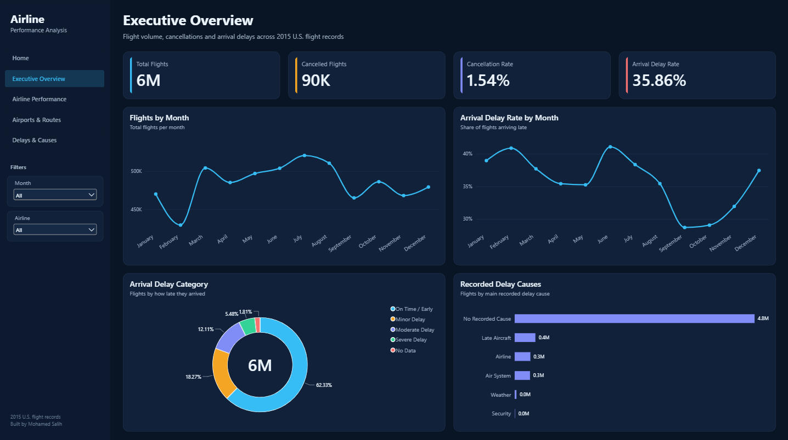
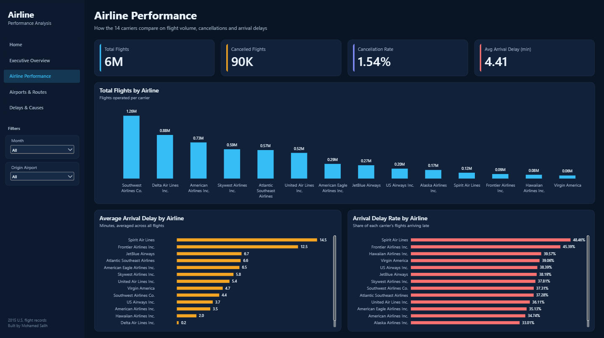
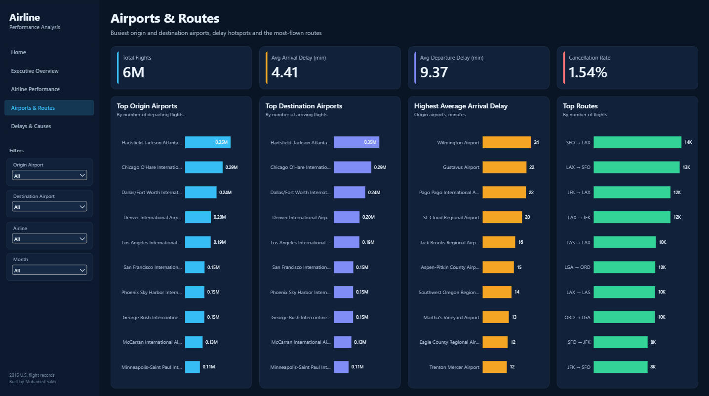
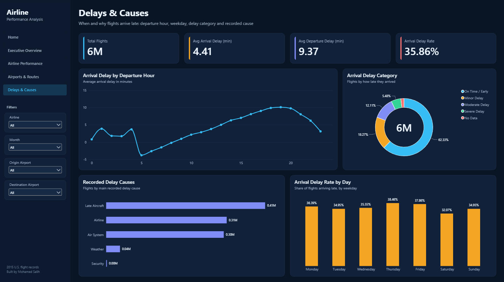
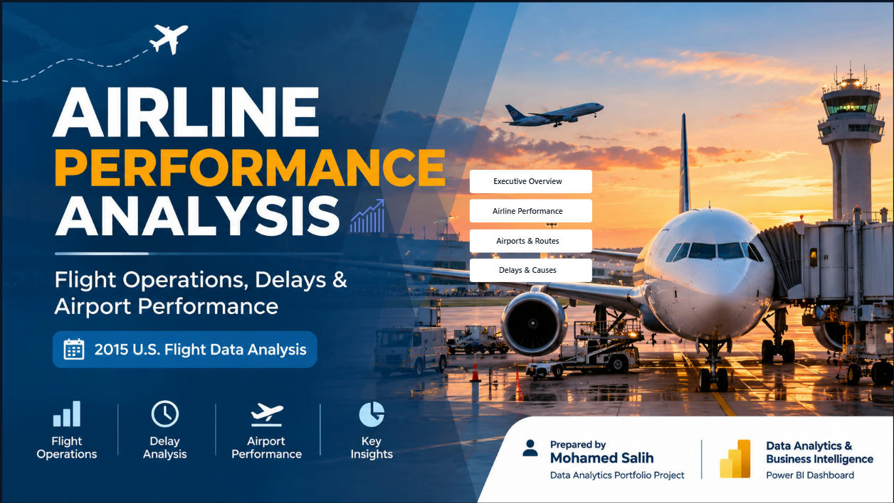

# ✈️ Airline Performance Analysis

End-to-end analysis of **5.8M U.S. flights (2015)** using **Python, Pandas and Power BI**, covering flight volume, cancellations, arrival and departure delays, delay causes, and airline, airport and route performance.



---

## 📊 Project Overview

This project analyzes airline flight performance using the 2015 U.S. Flight Delays and Cancellations dataset.

The project combines **Python, Pandas, SQL-style business analysis concepts, and Power BI** to transform raw flight data into an interactive business intelligence dashboard.

The analysis focuses on:

- Flight volume
- Flight cancellations
- Departure and arrival delays
- Delay causes
- Airline performance
- Airport performance
- Route performance
- Delay patterns by month, day, and departure hour

---

## 🎯 Business Questions

1. How many flights were operated?
2. What percentage of flights were cancelled?
3. Which airlines handled the largest number of flights?
4. Which airlines had higher arrival delay rates?
5. What were the main recorded causes of delays?
6. Which airports handled the highest number of flights?
7. Which routes had the highest flight volumes?
8. During which hours were arrival delays higher?
9. How did delays vary across days of the week?
10. How did airline and airport performance change when applying filters?

---

## 📁 Dataset

The dataset is based on the **2015 U.S. Flight Delays and Cancellations** data.

Main source tables: `flights.csv`, `airlines.csv`, `airports.csv`

| Item | Value |
|---|---:|
| Flights | 5,819,079 |
| Original columns | 31 |
| Airlines | 14 |
| Airports | 322 |

Because of their size, the raw CSV files are not included in this repository. The aggregated analysis tables produced by the Python scripts are in [`results/`](results).

---

## 🛠️ Technologies Used

| Area | Tools |
|---|---|
| Data preparation | Python, Pandas, NumPy |
| Analysis | Data cleaning, exploratory data analysis, business analysis, feature engineering |
| BI & visualization | Power BI, DAX, star schema, interactive slicers, KPI cards, bar, column, line and donut charts |
| Development | VS Code, Git, GitHub |

---

## 🔄 Project Workflow

```text
Raw Flight Data
       ↓
Python / Pandas
       ↓
Data Understanding
       ↓
Data Cleaning
       ↓
Business Analysis
       ↓
Star Schema Preparation
       ↓
Power BI Data Model
       ↓
DAX Measures
       ↓
Interactive Dashboard
       ↓
Business Insights
```

---

## 🧹 Data Preparation

The raw flight data was processed using Python. The cleaning process included:

- Handling missing values
- Creating flight date fields
- Creating delay, cancellation and diversion indicators
- Categorizing arrival delays
- Identifying the main recorded delay cause
- Calculating total delay causes
- Merging airline and airport information
- Creating analytical datasets

---

## ⭐ Power BI Data Model

A star schema was created to support interactive filtering and analysis.

**Fact table:** `fact_flights` (flight date, airline, flight number, origin and destination airport, departure and arrival delay, cancellation, diversion, delay category, main delay cause, distance)

**Dimension tables:** `dim_airline`, `dim_date`, `dim_origin_airport`, `dim_destination_airport`

```text
                 dim_airline
                     │
dim_date ─────── fact_flights ─────── dim_origin_airport
                     │
             dim_destination_airport
```

---

## 📐 DAX Measures

```DAX
Total Flights = COUNTROWS(fact_flights)

Cancelled Flights =
CALCULATE(COUNTROWS(fact_flights), fact_flights[IS_CANCELLED] = 1)

Cancellation Rate = DIVIDE([Cancelled Flights], [Total Flights])

Arrival Delay Rate =
DIVIDE(
    CALCULATE(COUNTROWS(fact_flights), fact_flights[IS_ARRIVAL_DELAYED] = 1),
    [Total Flights]
)

Average Arrival Delay = AVERAGE(fact_flights[ARRIVAL_DELAY])

Average Departure Delay = AVERAGE(fact_flights[DEPARTURE_DELAY])
```

---

## 📊 Dashboard

The report has a cover page and four analysis pages. Every analysis page shares the same layout: a sidebar with page navigation and filters, a row of KPI cards, and the charts below.

### Executive Overview

High-level view of flight operations: total flights, cancelled flights, cancellation rate, arrival delay rate, flights by month, arrival delay rate by month, arrival delay categories and recorded delay causes.


### Airline Performance

Compares the 14 carriers on flight volume, average arrival delay and arrival delay rate, filterable by month and origin airport.



### Airports & Routes

Top 10 origin airports, top 10 destination airports, origin airports with the highest average arrival delay, and the top 10 routes.



### Delays & Causes

Average arrival delay by departure hour, arrival delay categories, recorded delay causes and arrival delay rate by day of week.



### Cover Page



---

## 📈 Key Metrics

| Metric | Value |
|---|---:|
| Total Flights | 5,819,079 |
| Cancelled Flights | 89,884 |
| Cancellation Rate | 1.54% |
| Diverted Flights | 15,187 |
| Departure Delay Rate | 36.53% |
| Arrival Delay Rate | 35.86% |
| Average Departure Delay | 9.37 min |
| Average Arrival Delay | 4.41 min |

### Delay Categories

| Category | Flights |
|---|---:|
| On Time / Early | 3,627,112 |
| Minor Delay | 1,063,398 |
| Moderate Delay | 704,406 |
| Severe Delay | 319,092 |
| No Data | 105,071 |

### Recorded Delay Causes

The main recorded causes were Late Aircraft, Airline, Air System, Weather and Security. A large share of flights had no recorded delay cause in the available cause fields.

---

## 📝 Data Notes

- Some flights have airport codes that do not match an airport name, so they appear as *(Blank)* airports. These are excluded from the airport rankings in the dashboard.
- The Arrival Delay Category chart on the Executive Overview uses the category column from `fact_flights`, so it splits flights correctly by delay category.

---

## 📂 Project Structure

```text
airline-performance-analysis/
├── src/
│   ├── 01_data_understanding.py
│   ├── 02_data_cleaning.py
│   ├── 03_business_analysis.py
│   └── 04_powerbi_dataset.py
├── results/                          # aggregated analysis tables (CSV)
├── screenshots/                      # dashboard pages
├── Airline_Modern.pbip               # Power BI project (open in Power BI Desktop)
├── Airline_Modern.Report/            # report pages, visuals and theme
├── Airline_Modern.SemanticModel/     # data model, relationships and DAX measures (TMDL)
└── README.md
```

### Opening the Power BI project

The report is saved in Power BI Project (`.pbip`) format so the model and report can be read as text on GitHub. To open it with data, run the Python scripts to generate the CSV files, update the file paths in Power Query, then refresh in Power BI Desktop.

---

## 💡 Project Outcome

This project demonstrates an end-to-end data analytics workflow:

**Raw Data → Python → Data Cleaning → Business Analysis → Data Modeling → Power BI → Interactive Dashboard**

It combines technical data preparation with business-focused analysis and interactive visualization.

---

## 👨‍💻 Author

**Mohamed Salih**
Data Analytics | Data Science | Python | Power BI

- GitHub: [mosalih23-c](https://github.com/mosalih23-c)
- LinkedIn: [Mohamed Salih](https://www.linkedin.com/in/mohamed-salih-341bb0368/)
- Portfolio: [mosalih23-c.github.io/mohamed-salih-portfolio](https://mosalih23-c.github.io/mohamed-salih-portfolio/)
